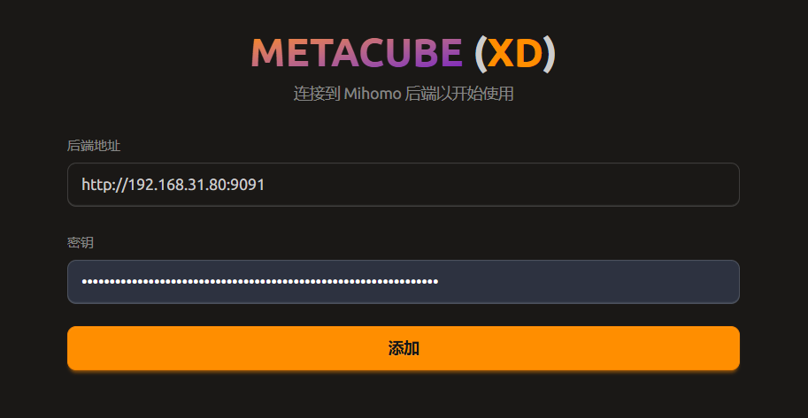
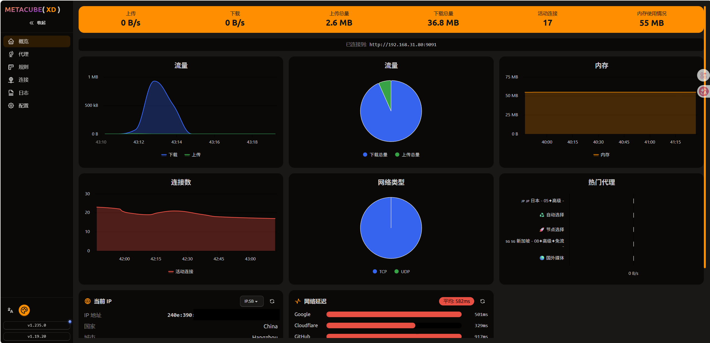

# clash-docker

基于 Mihomo 的 Clash 容器，支持订阅下载、定时更新、本地 YAML、可选 Subconverter 多订阅合并及代理账号密码认证。

镜像：[hhk0571/clash-for-linux](https://hub.docker.com/r/hhk0571/clash-for-linux)。

## 支持架构

镜像通过 Docker Buildx 构建，支持以下平台：

- `linux/amd64`
- `linux/arm64`（树莓派 4/5、Apple Silicon 等）
- `linux/arm/v7`（树莓派 3 等）

Docker 自动选择与宿主机匹配的镜像，无需手动指定架构。

## 主要特性

- 自动下载订阅，支持每日或按小时间隔更新。
- 可选本地 Subconverter，支持订阅格式转换及多订阅合并。
- 支持本地配置文件，无需提供订阅地址。
- 默认使用混合代理端口，同一入口支持 HTTP 和 SOCKS5。
- 支持单账号或多账号代理认证，与管理 API 密钥独立配置。
- 通过环境变量自定义代理与控制器端口，并校验格式、范围及端口冲突。
- 自动适配 Docker 网络设置，订阅更新后保留环境变量指定的认证和端口。
- 更新前校验配置，失败时保留或恢复上一份有效配置。
- 支持自定义下载 User-Agent、请求头及可选的 TLS 证书校验跳过。
- Python 核心流程，提供统一的启动、更新和健康检查命令。

## 快速开始

推荐使用仓库的 `docker-compose.yaml`。本次功能需要包含这些改动的镜像，本地可直接构建：

```bash
cp .env.example .env
# 编辑 .env，填写订阅、代理账号密码及独立的管理密钥
chmod 600 .env
docker compose up -d --build
docker compose logs -f clash
```

`.env` 示例：

```dotenv
CLASH_SUBSCRIPTION_URL=https://example.com/sub1,https://example.com/sub2
SUBCONVERTER_ENABLED=true
CLASH_PROXY_USERNAME=leo
CLASH_PROXY_PASSWORD=ReplaceWithLongRandomPassword
CLASH_API_SECRET=ReplaceWithAnotherRandomSecret
CLASH_MIXED_PORT=7890
CLASH_EXTERNAL_CONTROLLER_PORT=9090
```

多订阅需设置 `SUBCONVERTER_ENABLED=true`，否则只下载第一条 URL。

如果直接在 `docker-compose.yaml` 中维护多订阅，仍推荐 YAML 多行写法：每行一个地址，更容易阅读和增删。以下内容放在服务的 `environment` 下，替换原来的同名变量，不要重复声明：

```yaml
services:
  clash:
    environment:
      SUBCONVERTER_ENABLED: "true"
      CLASH_SUBSCRIPTION_URL: |
        https://example.com/sub1
        https://example.com/sub2
```

`|` 会将多行内容作为一个字符串传入容器，Python 按换行拆分订阅地址。若使用 `.env` 管理订阅，推荐前面的逗号分隔写法；不要把 YAML 的 `|` 语法复制到 `.env` 中。

不使用订阅时，清空 `CLASH_SUBSCRIPTION_URL`，将有效 Mihomo 配置放到 `./config/config.yaml`。未提供时使用镜像示例，其规则为直连，不包含代理节点。

也可直接运行已构建的镜像：

```bash
docker run -d --name clash \
  --env-file .env \
  -p 7890:7890 -p 9091:9090 \
  -v "$PWD/config":/app/config \
  --restart unless-stopped \
  hhk0571/clash-for-linux:latest
```

## 主要使用混合代理端口

**默认代理入口 mixed 7890 同时支持 HTTP 和 SOCKS5。** 客户端按所需协议连接同一端口，无需分别开放 HTTP/SOCKS 端口。

| 环境变量 | Mihomo 字段 | 默认值 | 用途 |
| --- | --- | --- | --- |
| `CLASH_MIXED_PORT` | `mixed-port` | 7890 | 主要代理入口，HTTP / SOCKS5 |
| `CLASH_HTTP_PORT` | `port` | 0 | 独立 HTTP，默认关闭 |
| `CLASH_SOCKS_PORT` | `socks-port` | 0 | 独立 SOCKS，默认关闭 |
| `CLASH_EXTERNAL_CONTROLLER_PORT` | `external-controller` | 9090 | 管理 API / 仪表盘 |

这些值会覆盖订阅和本地 YAML，未配置或空值使用表中默认值。代理端口允许 0–65535，0 表示关闭；控制器允许 1–65535。只接受 ASCII 十进制数字；前导零按十进制处理，不接受空格、正负号、小数或 `host:port`。启用端口不能重复。错误配置使启动或更新失败。

关闭的代理端口会从生成的 YAML 中移除，不写入 `port: 0` 等字段；订阅中已有的同名字段也会移除，确保保持关闭。默认只写入 `mixed-port`，显式开启独立 HTTP/SOCKS 端口后才写入对应字段。

Docker 映射为“宿主机端口:容器监听端口”。仓库默认：

```yaml
ports:
  - "${CLASH_MIXED_PORT:-7890}:${CLASH_MIXED_PORT:-7890}"
  - "9091:${CLASH_EXTERNAL_CONTROLLER_PORT:-9090}"
```

例如 mixed 改成 17890，Compose 映射变为 `17890:17890`；控制器改成 19090，映射变为 `9091:19090`，浏览器仍访问宿主机 9091。`docker run` 需要自行修改 `-p`。只调整宿主机入口则编辑映射左侧，无需修改环境变量。

如需独立 SOCKS `7891`，设置 `CLASH_SOCKS_PORT=7891` 并增加 `7891:7891` 映射；独立 HTTP 同理。设置 `CLASH_MIXED_PORT=0` 时必须删除它的映射。Compose/Docker 可能先于 Python 拒绝非法映射值。

迁移：原 HTTP 7890 客户端继续使用 mixed 7890；原 SOCKS 7891 客户端请改连 7890，或显式启用独立 SOCKS 端口。没有 `CLASH_PORT` 环境变量。

## 代理认证

`CLASH_PROXY_USERNAME` 和 `CLASH_PROXY_PASSWORD` 必须同时提供或同时留空：

- 同时提供：替换 `authentication`，清空 `skip-auth-prefixes`，应用于 HTTP/SOCKS/mixed。
- 同时留空且未设置多账号变量：保留原配置的认证和免认证网段；原配置没有认证时仍允许无认证访问。
- 只提供一个：启动或更新失败。

需要多个账号时，设置 `CLASH_PROXY_USERS_JSON`，并将上述单账号变量留空。使用 `docker run --env-file .env` 时，写成一行，不在 JSON 外加引号：

```dotenv
CLASH_PROXY_USERNAME=
CLASH_PROXY_PASSWORD=
CLASH_PROXY_USERS_JSON=[{"username":"alice","password":"password-a"},{"username":"bob","password":"password-b"}]
```

如果通过 Compose 的 `.env` 配置，可使用外层单引号保留 JSON 双引号及密码中的 `$` 字符；`docker run --env-file` 会保留外层单引号，不能照搬：

```dotenv
CLASH_PROXY_USERS_JSON='[{"username":"alice","password":"password-a"},{"username":"bob","password":"password-b"}]'
```

多账号变量与任何非空单账号变量同时设置时会报错。JSON 必须是非空数组，每项只能包含 `username`、`password` 两个非空字符串字段，用户名不能重复。JSON 内密码的双引号、反斜杠需按 JSON 规则转义。多账号使用同一套端口与代理规则，不提供按用户配额或独立路由。

显式配置单账号或多账号时，都会替换原认证列表并清空免认证网段；启动与订阅更新使用相同规则。空的 `CLASH_PROXY_USERS_JSON` 视为未设置，`[]` 则报错，避免意外取消认证。

用户名不能包含冒号，账号密码不能包含换行或控制字符。密码支持冒号、引号和反斜杠；`.env` 特殊字符仍需遵循 Compose 的引号和变量插值规则。

`CLASH_API_SECRET` 是独立的管理密钥，不是代理密码。认证不会加密客户端到代理的连接，公网访问应配合加密入口和访问限制。默认映射绑定所有宿主机接口；仅本机使用可改成 `127.0.0.1:7890:7890` 和 `127.0.0.1:9091:9090`。

```bash
# 无认证或错误密码：HTTP 407
curl -i -x http://127.0.0.1:7890 http://example.com
# 正确认证
curl -I -x http://127.0.0.1:7890 -U 'leo:your-password' https://example.com
curl -I --proxy socks5h://127.0.0.1:7890 --proxy-user 'leo:your-password' https://example.com
```

生成的运行配置与 `./config/config.yaml` 含明文认证信息，使用受限文件权限写入。保护挂载目录及备份；`.env` 已加入 Git 忽略规则。

## 其他环境变量

| 变量 | 默认值 / 说明 |
| --- | --- |
| `CLASH_SUBSCRIPTION_URL` | 可选；支持单 URL、逗号/分号或换行分隔多 URL |
| `CLASH_API_SECRET` | 空；非空时覆盖 YAML 管理密钥 |
| `CLASH_API` | 默认 `http://127.0.0.1:控制器端口`；显式设置可覆盖管理请求地址 |
| `SUBCONVERTER_ENABLED` | `false`；启用本地订阅转换和合并 |
| `SUBCONVERTER_URL` | `http://localhost:25500` |
| `CLASH_UPDATE_HOUR` | 3；每日小时，0–23 |
| `CLASH_UPDATE_INTERVAL` | 空；1–23 小时，从零点按 cron 步长更新；覆盖每日策略，无效值回退每日策略 |
| `CLASH_CRON_TEST` | 1 时每分钟更新 |
| `ALLOW_INSECURE_TLS` | `false`；`true` 时跳过下载证书校验 |
| `SUBSCRIPTION_USER_AGENT` | 完整 Chrome 浏览器 User-Agent；可自定义 |
| `SUBSCRIPTION_HEADERS` | 空；单个 `Name: value` 请求头 |
| `DISABLE_CLASH_DNS` | 空；`true/1/yes` 时禁用已有 `dns.enable` |
| `GEO_DAT_URL` | 默认 MetaCubeX 官方 Geo 数据发布地址；构建参数与运行时变量分别设置 |
| TZ | Compose 默认 `Asia/Shanghai` |

自定义下载选项等变量使用 Compose 时需加入 `environment` 才能进入容器；`.env` 不会自动把所有变量传给容器。

## 配置更新和运行管理

启动与更新共用 Python 流程：解析 YAML、应用覆盖、设置 `allow-lan`、控制器绑定 0.0.0.0，再使用 `Mihomo -t` 校验。未知 YAML 字段保留，注释和原排版不保留。

首次订阅下载或校验失败时依次尝试挂载配置和镜像示例；环境变量错误直接失败。无订阅时不启动 cron。Geo 文件优先使用挂载文件，其次使用镜像已有文件，缺少时尝试下载。

更新通过候选文件校验后原子替换；下载、校验失败保留有效配置。重载失败恢复旧文件并尝试恢复加载，返回失败状态。文件锁阻止并发更新，重载成功才同步挂载备份；备份失败明确记录警告。修改环境变量需重建容器。

订阅更新会覆盖仪表盘手工修改的配置。本地配置也会应用环境覆盖。入口 Shell 仅启动 Python，Python 管理 Mihomo、Subconverter、cron 的生命周期及退出。

## 仪表盘与维护

访问 `http://宿主机地址:9091/ui`，后端地址填 `http://宿主机地址:9091`，密钥填 `CLASH_API_SECRET`；未覆盖时使用 YAML `secret`。




```bash
docker compose up -d --build
docker compose down
docker compose logs -f clash
docker compose exec clash python3 /app/scripts/clash.py update
docker compose exec clash python3 /app/scripts/clash.py healthcheck
```

## 开发与测试

```bash
python -m pip install PyYAML==6.0.3
python -m unittest discover -s tests -v
docker build --build-arg TARGETARCH=amd64 --build-arg TARGETPLATFORM=linux/amd64 -t clash-test:local .
python tests/docker_smoke.py
```

容器冒烟测试需 Linux Docker，使用隔离网络和本地 HTTP 服务验证认证、HTTP/SOCKS5 mixed、自定义端口、更新和正常退出，无需外部代理节点。CI 执行 Python 测试及 amd64 冒烟测试；现有多架构构建保留，测试流程不发布镜像。

## buildx 构建
```bash
docker buildx build --load -t clash-test:local .
```


设置代理:
```bash
docker buildx build --load \
  --network=host \
  --build-arg http_proxy=http://127.0.0.1:7990 \
  --build-arg https_proxy=http://127.0.0.1:7990 \
  -t clash-test:local .
```

试着启动docker
```bash
cp .env.example .env
chmod 600 .env
# 编辑 .env，填写订阅、认证等配置

docker run -d \
  --name clash-test \
  --env-file .env \
  -p 127.0.0.1:7890:7890 \
  -p 127.0.0.1:9091:9090 \
  -v "$PWD/config":/app/config \
  clash-test:local

docker logs -f clash-test
```
